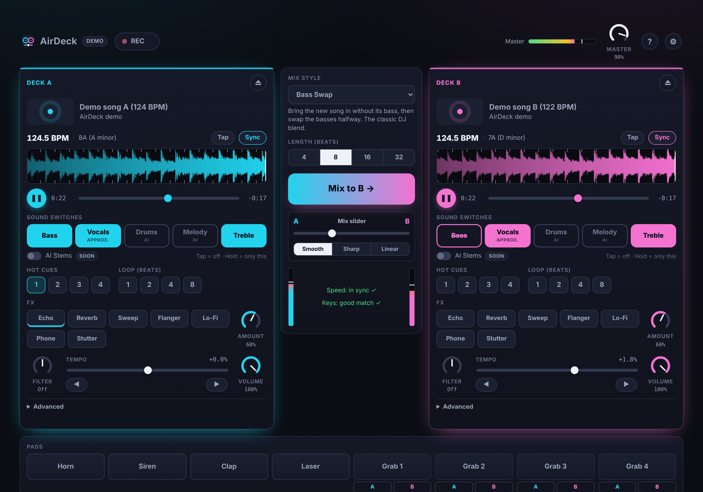

<p align="center">
  
</p>

<h1 align="center">AirDeck</h1>

<p align="center"><b>Turn your YouTube tabs into DJ decks.</b><br />
Mix two songs, switch the bass and vocals off and on, and record the result. It all runs in your browser.</p>

<p align="center">
  <a href="#install-2-minutes">Install</a> ·
  <a href="#60-second-guide">60-second guide</a> ·
  <a href="#is-it-safe">Is it safe?</a> ·
  <a href="#not-working">Help</a> ·
  <a href="docs/ARCHITECTURE.md">How it works</a>
</p>



AirDeck is a Chrome extension. Send any two YouTube tabs to **Deck A** and **Deck B**, and a single **Mixer** tab takes over their sound. From there you can:

- **Switch parts of a song off and on**: Bass, Vocals and Treble. Hold a switch to hear only that part.
- **Match speeds** with one **Sync** button. AirDeck finds each song's tempo by itself.
- **Change songs with one tap.** Pick a mix style (Bass Swap, Echo Out, Smooth Fade and five more), then press **Mix**.
- **Play with it**: loops, hot cues, FX pads (echo, reverb, flanger…), and sample pads (air horn, siren…).
- **Record your mix** and save it as a file.

No account, no server, nothing to pay for. AirDeck never downloads YouTube audio. It only mixes what is already playing in your own tabs.

## Install (2 minutes)

AirDeck isn't on the Chrome Web Store, so you load it yourself. There is nothing to build.

1. Download this repo: green **Code** button → **Download ZIP**, then unzip it.
2. Open `chrome://extensions` in Chrome.
3. Turn on **Developer mode** (top right).
4. Click **Load unpacked** and pick the unzipped folder (the one with `manifest.json` directly inside it).
5. Pin it: click the puzzle-piece icon in the toolbar, then the pin next to **AirDeck**.

A welcome page opens. To try AirDeck straight away without YouTube, click **Try it now with demo songs**.

You need Chrome 116 or newer. Other Chromium browsers (Edge, Brave, Arc) should work too. Keep the folder where it is: Chrome loads the extension from it, so moving or deleting the folder removes the extension.

**To update**, download the new ZIP, replace the folder, and click the reload arrow on AirDeck's card in `chrome://extensions`.

## 60-second guide

1. **Load Deck A.** Open a YouTube video and press <kbd>Alt</kbd>+<kbd>Shift</kbd>+<kbd>1</kbd>. You can also click the AirDeck icon and choose **Send to Deck A**. The Mixer tab opens, and the video shows a small "On Deck A" badge.
2. **Load Deck B.** Open a second video in another tab and press <kbd>Alt</kbd>+<kbd>Shift</kbd>+<kbd>2</kbd>.
3. **Press play** on Deck A in the Mixer. After about 10 seconds the tempo appears (for example "124.0 BPM").
4. **Press Sync** on Deck B. Both songs now play at the same speed.
5. **Press the big Mix button.** Deck B fades in, Deck A fades out, and you've done your first transition.

Then play around. Tap **Bass** to drop the bass, hold **Vocals** to hear mostly the singer, or hold **Echo** for an effect. Press **REC** to record.

> Chrome only lets an extension capture a tab's sound after you click the extension or press its shortcut *on that tab*. That's why loading a deck always starts on the YouTube tab.

## What you can do

| | |
|---|---|
| **Sound switches** | **Bass**, **Vocals** (approximate) and **Treble**. Tap a switch to turn that part off, and hold it to hear only that part. **Drums** and **Melody** need AI Stems, which isn't built yet. |
| **Sync and tempo** | Tempo is found automatically, and **Tap** lets you set it by hand. **Sync** matches the other deck's speed. The tempo slider covers ±8% (±16% in Settings), and the pitch stays the same. **◀ ▶** nudge the deck slower or faster for a moment. |
| **Mix styles** | Smooth Fade · Bass Swap · Echo Out · Filter Fade · Riser Build · Quick Cut · Spinback · Brake. Choose a length of 4, 8, 16 or 32 beats. Tap **Mix** again to cancel smoothly. |
| **Mix slider** | Three curves: Smooth (even volume, the default), Sharp (for quick cuts) and Linear. |
| **Filter** | One knob. Turn it left for a muffled sound and right for a thin one. |
| **Loops and cues** | Loop the last 1, 2, 4 or 8 beats, and tap again to carry on. There are four hot cues per deck, and they are remembered for each song. |
| **FX** | Echo, Reverb, Sweep, Flanger, Lo-Fi, Phone and Stutter. Hold a pad for a moment, or double-tap it to keep it on. One **Amount** knob sets how strong they are. |
| **Pads** | Horn, Siren, Clap and Laser, all made in code. Four **Grab** pads store the last bar of either deck. |
| **Key** | Shows each song's key (for example "8A (A minor)"), and the Mixer tells you whether the two keys sound good together. |
| **Safety** | Auto level match keeps both songs equally loud. A limiter keeps the mix from distorting. Ads are muted automatically ("Ad playing"). |
| **Record** | Records the mix as WebM (small) or WAV (best quality). |

### Keyboard shortcuts (in the Mixer)

| Keys | Action |
|---|---|
| <kbd>Q</kbd> <kbd>W</kbd> <kbd>E</kbd> | Deck A: Bass, Vocals and Treble off/on (add <kbd>Shift</kbd> to hear only that part) |
| <kbd>U</kbd> <kbd>I</kbd> <kbd>O</kbd> | Deck B: Bass, Vocals and Treble off/on |
| <kbd>R</kbd> / <kbd>P</kbd> | Hold for Echo on Deck A / Deck B |
| <kbd>Z</kbd> / <kbd>M</kbd> | Play or pause Deck A / Deck B |
| <kbd>Space</kbd> | Mix to the other deck (press again to cancel) |
| <kbd>←</kbd> <kbd>→</kbd> | Move the mix slider |
| <kbd>1</kbd>–<kbd>4</kbd>, <kbd>7</kbd>–<kbd>0</kbd> | Hot cues for Deck A, Deck B |
| <kbd>?</kbd> | Help |

The "send to deck" shortcuts (<kbd>Alt</kbd>+<kbd>Shift</kbd>+<kbd>1</kbd> / <kbd>2</kbd>) can be changed at `chrome://extensions/shortcuts`.

## Is it safe?

Yes. All the code is in this repo, written in plain JavaScript with no build step, so the files you load are the files you can read.

- **No internet use.** AirDeck makes no network requests. Its security policy (in `manifest.json`) only lets the Mixer load YouTube thumbnail images from `i.ytimg.com`. There is no server, account, analytics or tracking.
- **It only touches YouTube.** The content script runs on `youtube.com` and nowhere else. It plays, pauses, seeks and reads the video title. It never reads your account, comments or history.
- **Nothing is downloaded or saved** except a mix you choose to record. YouTube audio is only mixed live.
- **Nothing to install or run.** There are no .exe or .dmg files. Chrome runs AirDeck inside its own sandbox like any other extension.
- **No third-party code ships in the extension.** Every sound effect, pad and test track is generated in code.

Why each permission is needed:

| Permission | Why |
|---|---|
| `tabCapture` | To take the sound of a YouTube tab you send to a deck. |
| `tabs` | To find, focus and track the Mixer and deck tabs. |
| `scripting` | To add the deck controls to a YouTube tab that was open before you installed AirDeck. |
| `storage` | To remember your settings, hot cues and each song's tempo and key. |
| Access to `youtube.com` | To control the video (play, pause, seek, speed) and show the "On Deck A" badge. |

Chrome may show a "Disable developer mode extensions" notice now and then. That's normal for anything not from the Web Store. Click the X to keep AirDeck.

## Tips

- **Mix songs with similar tempos.** Sync covers ±16%, so a 120 BPM song mixes well with anything from about 100 to 140 BPM.
- **Use Bass Swap for most changes.** It stops the two kick drums from fighting.
- **Stay in the Mixer tab.** You can switch to other tabs, but closing the Mixer gives every YouTube tab its sound back.
- **Wait for the BPM.** It appears after roughly 10 seconds of playback. If it doesn't, tap **Tap** along to the beat four or more times.
- **Vocals is approximate.** It removes whatever is panned to the centre, which is usually the singer, but some songs keep a little of the voice.

## Not working?

- **"Manifest file is missing":** you picked the wrong folder. Pick the one that has `manifest.json` directly inside it.
- **"Chrome needs a click to share tab audio":** press the shortcut, or click the AirDeck icon, *while you're on that YouTube tab*.
- **"That tab is already being shared":** eject it from its deck first (⏏ on the deck), or close any other app that is capturing that tab.
- **The Mixer is silent:** click **Click to start AirDeck** if you see it, check the Master knob, and make sure the deck is playing (▶).
- **Alt+Shift+1 does nothing:** another app may own that shortcut. Change it at `chrome://extensions/shortcuts`.
- **"Finding the beat…" forever:** some songs have no steady beat, such as intros or ambient tracks. Use **Tap**.
- **The deck says "Ad playing":** it unmutes by itself when the ad ends.

## What's in v0.1

AirDeck follows the plan in [PRD.md](PRD.md). This first release covers the whole everyday mixing experience. [DECISIONS.md](DECISIONS.md) explains every way the build differs from that plan.

| Area | Status |
|---|---|
| Tab capture for 2 decks, popup, shortcuts, badge, Mixer | ✅ Done (two-tab capture verified in Chromium) |
| Bass/Vocals/Treble switches, filter, mix slider, limiter, auto level, ad guard | ✅ Done |
| BPM detection, Tap, Sync, nudge, 8 mix styles, record | ✅ Done |
| Loops, hot cues, stutter, grab pads, synth pads, waveforms, meters | ✅ Done |
| Key detection with Camelot codes and a "good match" hint | ✅ Done |
| Key match (pitch shift), automatic beat alignment | 🔜 Planned |
| AI Stems (Drums/Melody switches, Vocal Handoff, Mashup) | 🔜 Planned |
| Auto-DJ queue, decks C/D, MIDI controllers, hand-gesture control | 🔜 Planned |

## For developers

AirDeck is plain ES modules. Chrome loads the source folder directly, and Node is only needed to run the checks.

```bash
npm install
```

```bash
npm run check
```

This runs type checking (`tsc` over JSDoc), ESLint, Vitest unit tests and Playwright end-to-end tests. The real two-tab capture test needs a headed browser:

```bash
npm run e2e:capture
```

On Linux without a display, run it under Xvfb:

```bash
xvfb-run -a npm run e2e:capture
```

Further reading:

- [docs/ARCHITECTURE.md](docs/ARCHITECTURE.md) explains how the pieces fit together, with the audio graph.
- [docs/TESTING.md](docs/TESTING.md) covers what is tested automatically and the manual YouTube checklist.
- [CONTRIBUTING.md](CONTRIBUTING.md) describes the project layout and rules.
- [CLAUDE.md](CLAUDE.md) holds the rules for AI coding agents working on this repo.

## Privacy

AirDeck processes audio on your computer and keeps nothing except what you ask it to: settings, hot cues, each song's tempo and key in Chrome's local extension storage, and any recording you download. Nothing is sent anywhere.

## Credits

Made by Aman Chaturvedi. MIT licensed: see [LICENSE](LICENSE).

AirDeck bundles no third-party code. See [THIRD_PARTY_NOTICES.md](THIRD_PARTY_NOTICES.md) for the development-only tools. YouTube is a trademark of Google LLC. AirDeck is not affiliated with or endorsed by YouTube or Google.
